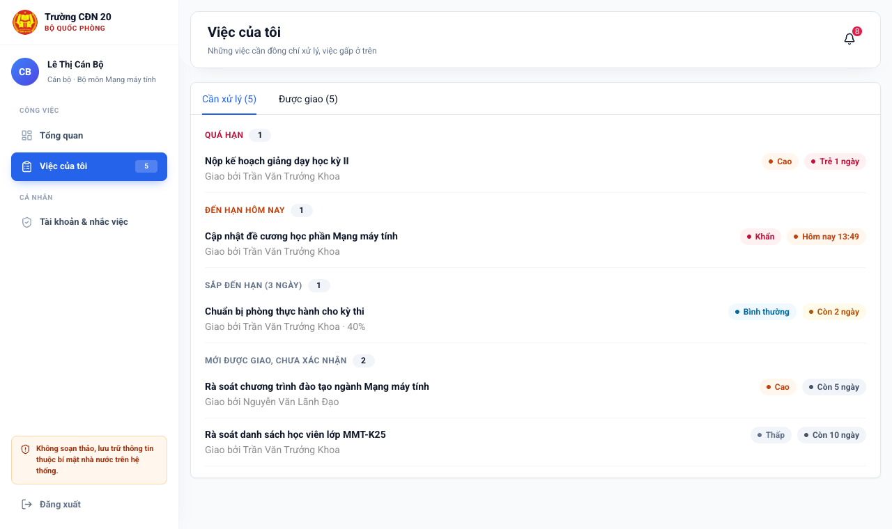
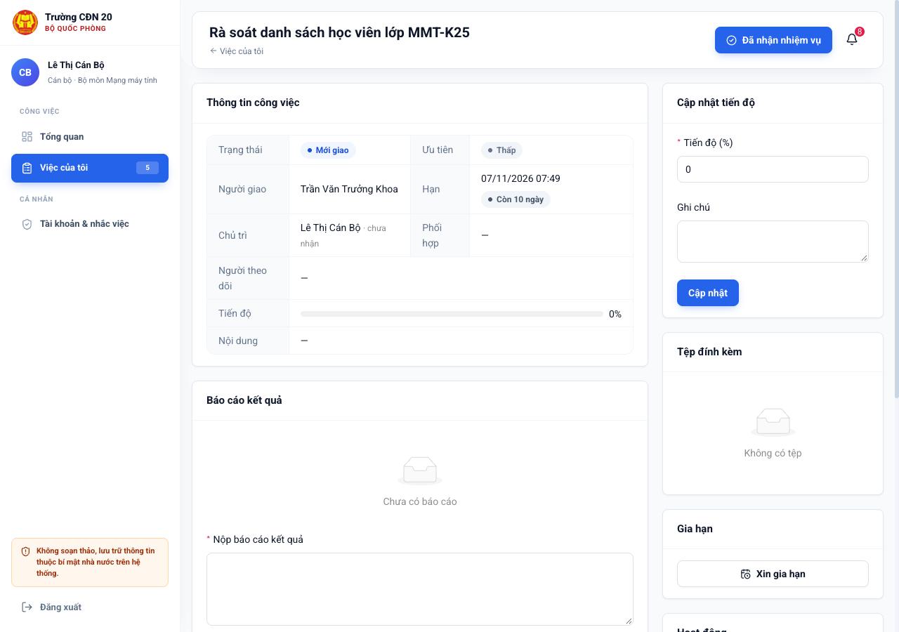
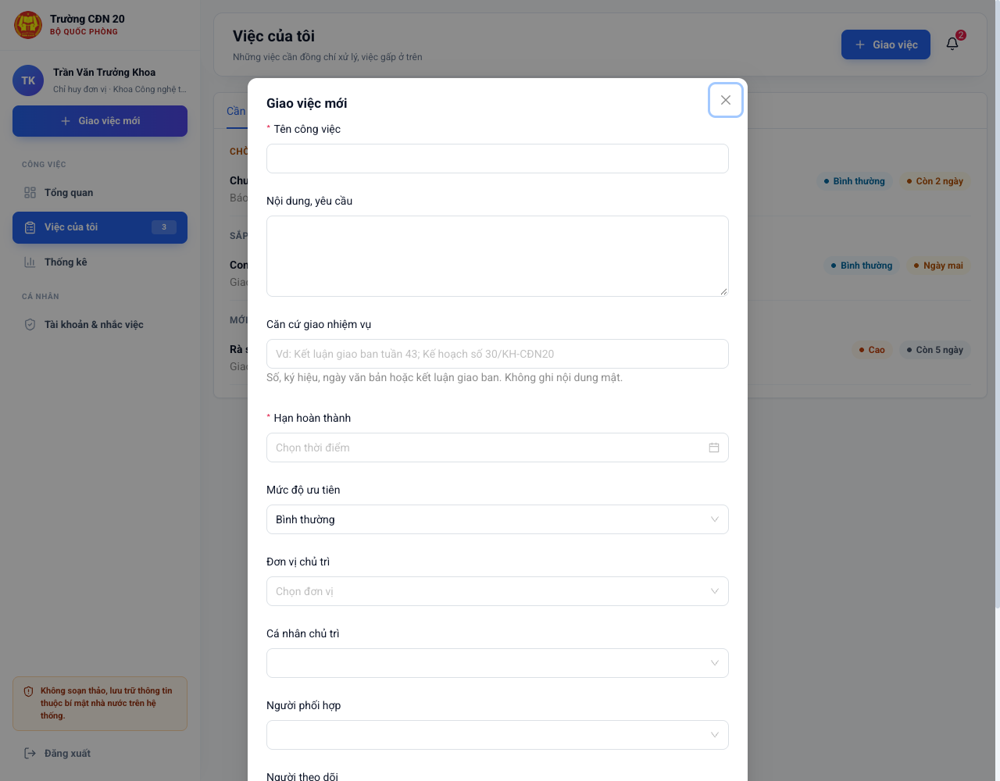
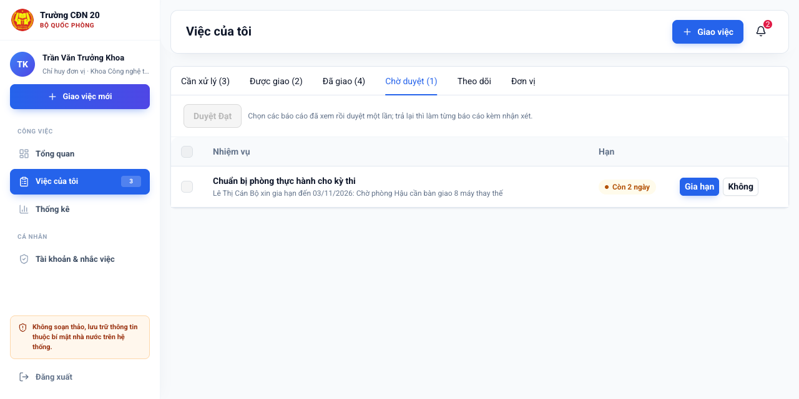
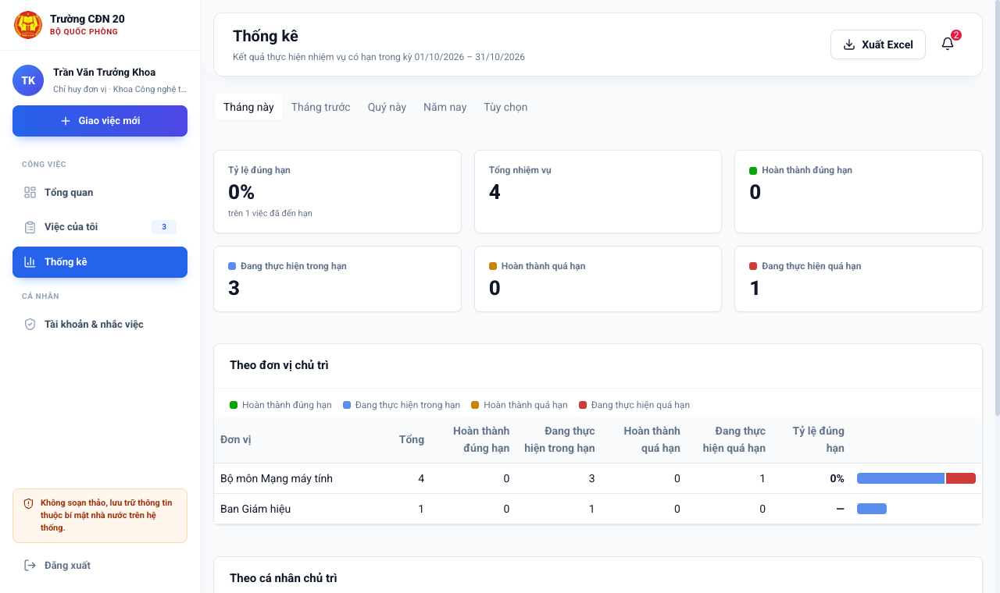
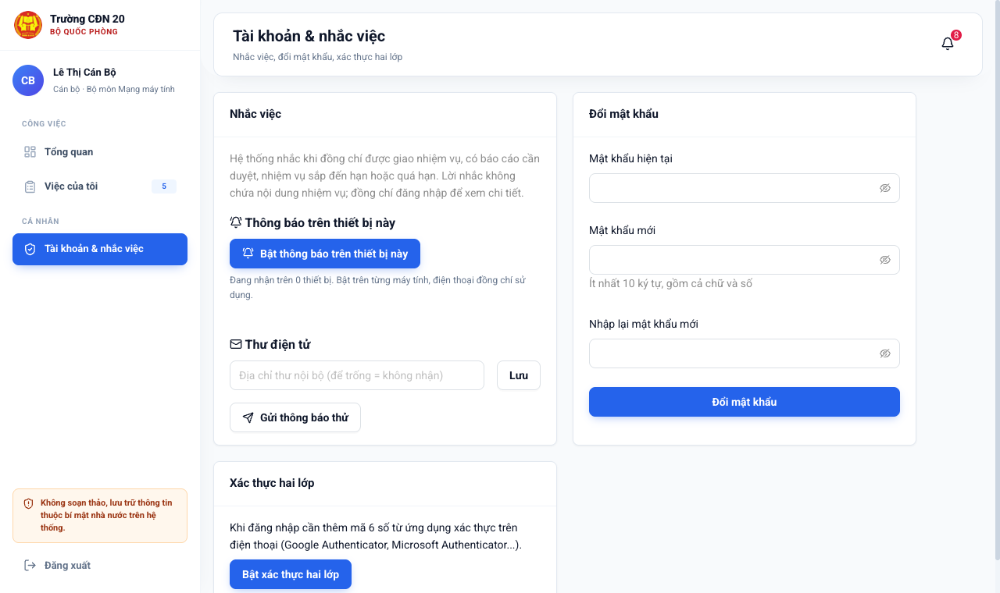

# Hướng dẫn sử dụng: Hệ thống giao nhiệm vụ

Hệ thống dùng để giao nhiệm vụ, báo cáo kết quả và theo dõi tiến độ trong Nhà trường. Dùng trên máy tính (trình duyệt),
trên điện thoại (trình duyệt hoặc ứng dụng "Giao nhiệm vụ").

> **Không soạn thảo, lưu trữ, truyền đưa thông tin thuộc bí mật nhà nước trên hệ thống.**
> Căn cứ giao nhiệm vụ chỉ ghi số hiệu, trích yếu văn bản; không đính kèm văn bản mật.

Mục lục:
1. [Bắt đầu](#1-bắt-đầu) (mọi người)
2. [Cán bộ: nhận và thực hiện nhiệm vụ](#2-cán-bộ-nhận-và-thực-hiện-nhiệm-vụ)
3. [Chỉ huy đơn vị: nhận việc của đơn vị, phân tiếp, giao việc](#3-chỉ-huy-đơn-vị)
4. [Lãnh đạo: giao việc, duyệt, theo dõi, thống kê](#4-lãnh-đạo)
5. [Quản trị hệ thống](#5-quản-trị-hệ-thống)
6. [Nhắc việc trên điện thoại](#6-nhắc-việc-trên-điện-thoại)
7. [Câu hỏi thường gặp](#7-câu-hỏi-thường-gặp)

---

## 1. Bắt đầu

**Đăng nhập lần đầu**
1. Mở địa chỉ hệ thống do bộ phận quản trị cung cấp, nhập tên đăng nhập và **mật khẩu tạm**.
2. Hệ thống yêu cầu **đổi mật khẩu**: ít nhất 10 ký tự, có cả chữ và số. Không dùng lại mật khẩu của tài khoản khác.
3. Tài khoản **Lãnh đạo, Quản trị** phải bật **xác thực hai lớp** ngay: cài ứng dụng Google Authenticator hoặc Microsoft
   Authenticator trên điện thoại, quét mã QR, nhập mã 6 số. Từ đó mỗi lần đăng nhập cần thêm mã 6 số trong ứng dụng.
   Cán bộ khác nên bật tại trang **Tài khoản & nhắc việc**.

**Màn hình chính**
- **Tổng quan**: số nhiệm vụ theo trạng thái, việc cần xử lý.
- **Việc của tôi**: nơi làm việc hằng ngày (xem mục 2).
- **Thống kê** (lãnh đạo, chỉ huy): kết quả thực hiện nhiệm vụ theo kỳ.
- Biểu tượng **chuông**: thông báo mới; bấm vào thông báo để mở đúng nhiệm vụ.
- **Tài khoản & nhắc việc**: bật nhắc việc trên điện thoại, đổi mật khẩu, xác thực hai lớp.

**Hạn nhiệm vụ** hiển thị theo mức gấp: *Trễ 3 ngày* (đỏ), *Hôm nay 17:00* (cam), *Ngày mai*, *Còn 2 ngày*
(vàng), *Còn 10 ngày* (xám).

**An toàn tài khoản**: không cho người khác dùng tài khoản; đăng xuất khi rời máy dùng chung; nhập sai mật khẩu 5 lần
tài khoản bị khóa 15 phút. Mọi lần đăng nhập, mọi thao tác đều được ghi nhật ký.

## 2. Cán bộ: nhận và thực hiện nhiệm vụ

**Việc của tôi** chia thành các mục:
- **Cần xử lý** (mặc định): việc quá hạn, đến hạn hôm nay, bị trả lại, sắp đến hạn (3 ngày), mới được giao chưa xác nhận.
  Việc gấp ở trên. Làm hết mục này là không bỏ sót việc.
- **Được giao**: mọi việc giao cho đồng chí.
- **Theo dõi**: việc đồng chí được thêm làm người theo dõi (chỉ xem).

**Thực hiện một nhiệm vụ** (bấm tên nhiệm vụ để mở):

1. Bấm **Đã nhận nhiệm vụ** để người giao biết đồng chí đã nhận.
2. Trong quá trình làm: **Cập nhật tiến độ** (%), ghi chú ngắn. Hỏi thêm người giao ở mục **Trao đổi**.
3. Không kịp hạn: bấm **Xin gia hạn**, chọn hạn mới, ghi lý do. Người giao chấp thuận thì hạn tự đổi.
4. Xong: **Nộp báo cáo kết quả**, ghi nội dung, đính kèm tệp (PDF, Word, Excel, PowerPoint, ảnh; tối đa 20 MB mỗi tệp).
5. Người giao **duyệt Đạt** thì nhiệm vụ hoàn thành; **Trả lại** thì xem nhận xét, làm tiếp và nộp lại.

Mục **Hoạt động** ghi lại toàn bộ quá trình: ai giao, ai nhận, cập nhật, gia hạn, nộp, duyệt, lúc nào.

## 3. Chỉ huy đơn vị

Ngoài các việc như cán bộ:

**Nhận việc giao cho đơn vị**
- Việc giao cho đơn vị hiện trong mục **Cần xử lý** của chỉ huy đơn vị. Bấm **Đã nhận nhiệm vụ** thay cho đơn vị.
- Bấm **Chia việc con** để phân tiếp cho cán bộ trong đơn vị. Nhiệm vụ cha hiện danh sách việc con, tiến độ từng việc
  ("Việc con: 2/5 hoàn thành").
- Mục **Đơn vị**: mọi nhiệm vụ của đơn vị mình và đơn vị trực thuộc.

**Giao việc** (nút **Giao việc mới**): chỉ giao được trong đơn vị mình và đơn vị trực thuộc. Cách giao như mục 4.

**Duyệt báo cáo, đề nghị gia hạn** của việc mình giao: mục **Chờ duyệt** (xem mục 4).

**Thống kê** đơn vị mình: mục 4.

## 4. Lãnh đạo

**Giao việc**: bấm **Giao việc mới**.

- **Tên công việc**, **nội dung, yêu cầu** rõ ràng; **hạn hoàn thành**; **mức độ ưu tiên** (Khẩn: nhắc ngay, cần làm trước).
- **Căn cứ giao nhiệm vụ**: số hiệu văn bản, kết luận giao ban (vd. "Kết luận giao ban tuần 43"). Không ghi nội dung mật.
- **Đơn vị chủ trì** hoặc **cá nhân chủ trì** (bắt buộc ít nhất một), **người phối hợp**.
- **Người theo dõi**: người cần nắm tình hình mà không phải làm (vd. trợ lý, Văn phòng).
- **Tệp đính kèm**: văn bản chỉ đạo, biểu mẫu.

Người được giao nhận thông báo ngay (trong hệ thống, điện thoại, thư điện tử nếu đã bật).

**Theo dõi, đôn đốc**
- Mục **Đã giao**: mọi việc mình giao; xem ai **đã nhận / chưa nhận**, tiến độ, hạn.
- Việc chậm: mở nhiệm vụ, bấm **Đôn đốc**. Người thực hiện nhận ngay lời nhắc "khẩn trương thực hiện" (tối đa 3 lần
  mỗi ngày mỗi nhiệm vụ).
- **Sửa** nhiệm vụ (đổi hạn, nội dung, mức ưu tiên), **thêm người theo dõi**, **hủy việc** khi không còn cần.
  Đổi hạn, hủy thì người thực hiện, người theo dõi nhận thông báo.
- Muốn nắm một việc do người khác giao: mở nhiệm vụ, bấm **Theo dõi**; việc hiện trong mục **Theo dõi**.

**Duyệt** (mục **Chờ duyệt**)

- Báo cáo kết quả: bấm **Duyệt** (Đạt, nhiệm vụ hoàn thành) hoặc **Trả lại** kèm nhận xét, yêu cầu bổ sung.
- Nhiều báo cáo đã xem: đánh dấu chọn rồi bấm **Duyệt Đạt** một lần.
- Đề nghị gia hạn: **Gia hạn** (chấp thuận) hoặc **Không** kèm lý do.

**Thống kê** (menu **Thống kê**)

- Chọn kỳ: tháng này, tháng trước, quý, năm hoặc tùy chọn. Tính các nhiệm vụ **có hạn trong kỳ**, không tính việc đã hủy.
- 4 nhóm: **hoàn thành đúng hạn**, **hoàn thành quá hạn**, **đang thực hiện trong hạn**, **đang thực hiện quá hạn**;
  **tỷ lệ đúng hạn** = hoàn thành đúng hạn / (hoàn thành + đang thực hiện quá hạn).
- Bảng theo **đơn vị chủ trì**, theo **cá nhân chủ trì** (kèm số việc đang làm, tức khối lượng hiện tại), theo tháng.
- **Xuất Excel** để đưa vào báo cáo giao ban, sơ kết. Ở **Việc của tôi**, mỗi mục cũng có nút **Xuất Excel** danh sách
  nhiệm vụ (theo bộ lọc đang chọn).

## 5. Quản trị hệ thống

Tài khoản quản trị **không xem được nội dung nhiệm vụ**; chỉ quản lý tài khoản, đơn vị, nhật ký.

**Đơn vị**: thêm, sửa tên, chuyển đơn vị cha, ẩn đơn vị không còn dùng. Muốn ẩn: chuyển hết cán bộ sang đơn vị khác và
ẩn các đơn vị trực thuộc trước. Đơn vị đã ẩn không chọn được khi giao việc, tạo tài khoản; dữ liệu cũ vẫn giữ.

**Tài khoản**
- **Thêm tài khoản**: nhập thông tin, mật khẩu tạm; người dùng phải đổi ở lần đăng nhập đầu.
- **Nhập từ Excel**: tải tệp mẫu, điền mỗi người một dòng (mã đơn vị lấy ở trang Đơn vị; vai trò: Cán bộ, Chỉ huy đơn vị,
  Lãnh đạo), chọn tệp, xem trước, tạo. Tệp có lỗi thì báo từng dòng, chưa tạo tài khoản nào. Tạo xong **tải danh sách
  mật khẩu tạm**, phát riêng từng người, **xóa tệp sau khi phát xong**.
- **Sửa**: đổi thông tin, **chuyển đơn vị**, vai trò. Đổi vai trò thì người dùng phải đăng nhập lại.
- **Khóa** (tắt công tắc Hoạt động) khi cán bộ chuyển công tác, nghỉ: đăng xuất ngay mọi nơi.
- Nút **…**: **đặt lại mật khẩu**; **mở khóa đăng nhập** (bị khóa do nhập sai nhiều lần); **đặt lại xác thực hai lớp**
  khi cán bộ mất, đổi điện thoại. Chỉ làm sau khi **xác minh trực tiếp đúng người**.

**Nhật ký hệ thống**: tra cứu theo người dùng, khoảng ngày, kết quả (thành công / lỗi, bị từ chối), hành động. Nhật ký
không sửa, xóa được. Nên xem định kỳ các lần **đăng nhập sai**, **bị khóa**.

## 6. Nhắc việc trên điện thoại

Hệ thống nhắc khi được giao việc, có báo cáo cần duyệt, báo cáo được duyệt/trả lại, được đôn đốc, đổi hạn; **7h sáng**
hằng ngày nhắc gộp các việc sắp đến hạn, quá hạn. Lời nhắc **chỉ có câu chung**, không có tên, nội dung nhiệm vụ; bấm
vào để mở hệ thống xem chi tiết.

**Cách 1. Ứng dụng "Giao nhiệm vụ"** (Android, iPhone; cài theo hướng dẫn của bộ phận quản trị khi phát hành)

Mở ứng dụng là thấy ngay mục **Cần xử lý**; nhận việc, cập nhật tiến độ, nộp báo cáo (chụp ảnh kèm theo), duyệt ngay trên
điện thoại.

**Cách 2. Trình duyệt trên điện thoại**
- **Android**: mở hệ thống bằng Chrome, vào **Tài khoản & nhắc việc**, bấm **Bật thông báo trên thiết bị này**, cho phép.
- **iPhone** (iOS 16.4 trở lên): mở bằng **Safari** → nút **Chia sẻ** → **Thêm vào MH chính** → mở hệ thống từ biểu tượng
  mới trên màn hình chính → **Tài khoản & nhắc việc** → **Bật thông báo trên thiết bị này**.
- Bấm **Gửi thông báo thử** để kiểm tra.

**Thư điện tử**: nhập địa chỉ thư nội bộ ở **Tài khoản & nhắc việc** để nhận thêm lời nhắc qua thư.

Đăng xuất thì thiết bị đó thôi nhận nhắc việc của tài khoản.

## 7. Câu hỏi thường gặp

**Quên mật khẩu, bị khóa tài khoản?** Báo bộ phận quản trị để đặt lại mật khẩu hoặc mở khóa (phải xác minh đúng người).

**Mất, đổi điện thoại, không còn mã xác thực hai lớp?** Báo bộ phận quản trị đặt lại xác thực hai lớp; đăng nhập lại và
bật trên điện thoại mới.

**Không thấy nhiệm vụ của người khác?** Đúng quy định: mỗi người chỉ thấy việc mình giao, được giao, theo dõi; chỉ huy
thấy việc của đơn vị mình; lãnh đạo thấy toàn trường.

**Không nhận được thông báo trên điện thoại?** Kiểm tra đã bật ở **Tài khoản & nhắc việc** chưa, điện thoại có cho phép
thông báo không (iPhone: phải mở từ biểu tượng trên màn hình chính). Bấm **Gửi thông báo thử**.

**Tải tệp lên bị từ chối?** Chỉ nhận PDF, Word, Excel, PowerPoint, ảnh, tối đa 20 MB; tệp đổi đuôi (vd. tệp chạy được
đổi thành .pdf) bị chặn.
